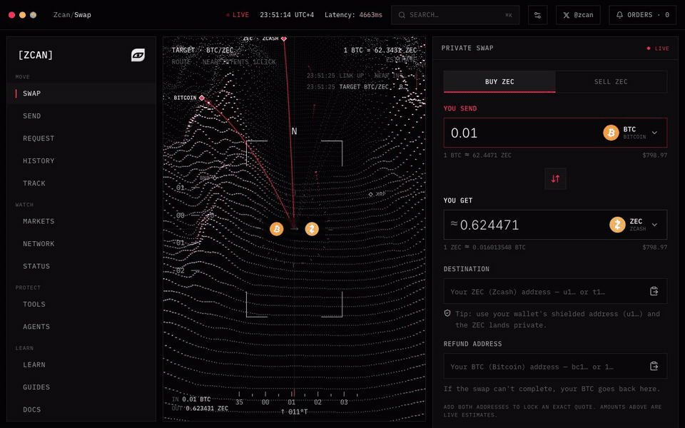
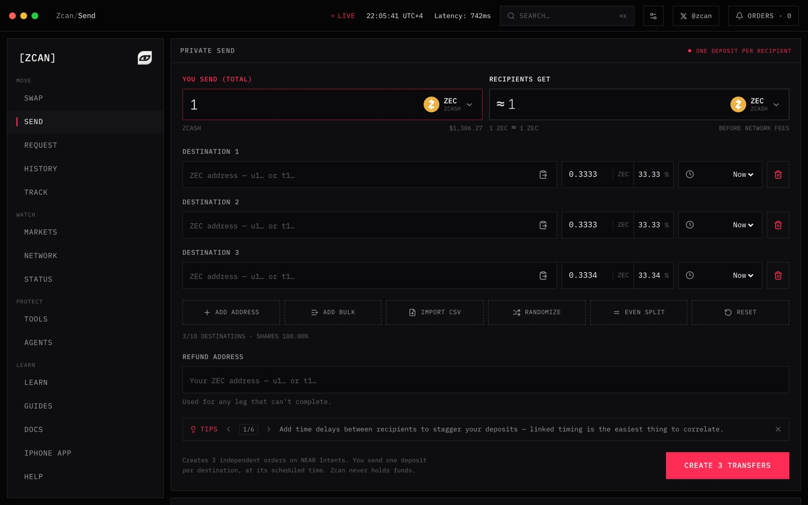
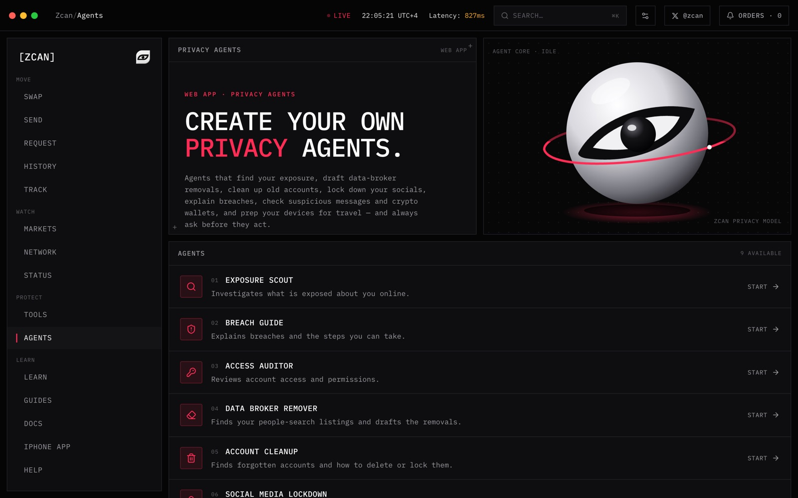
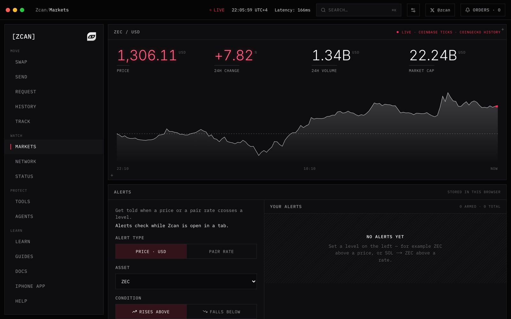
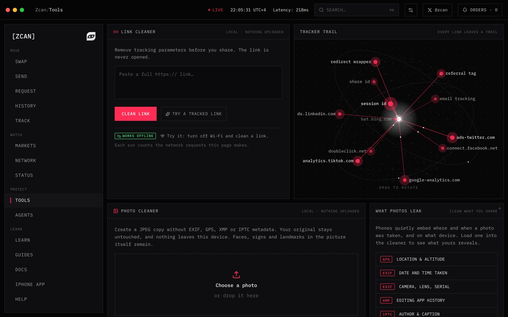
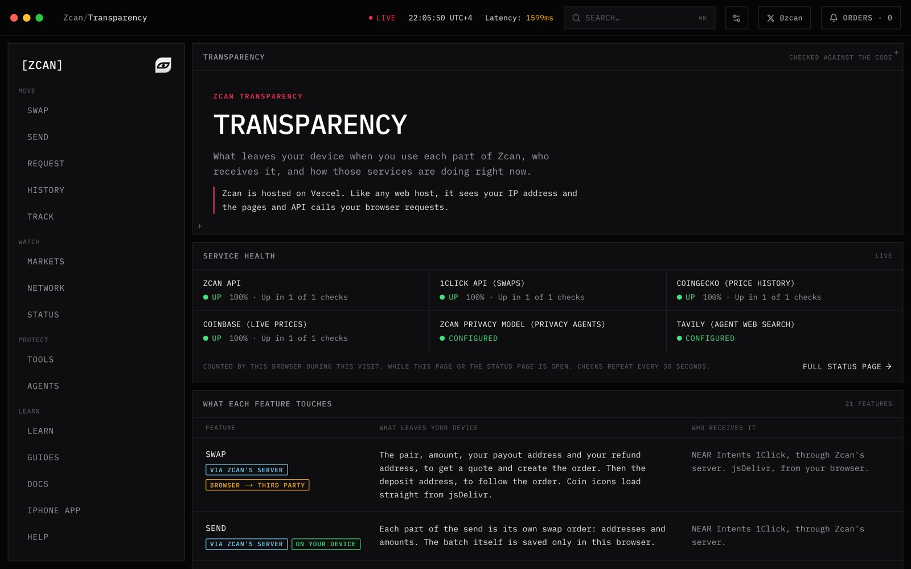
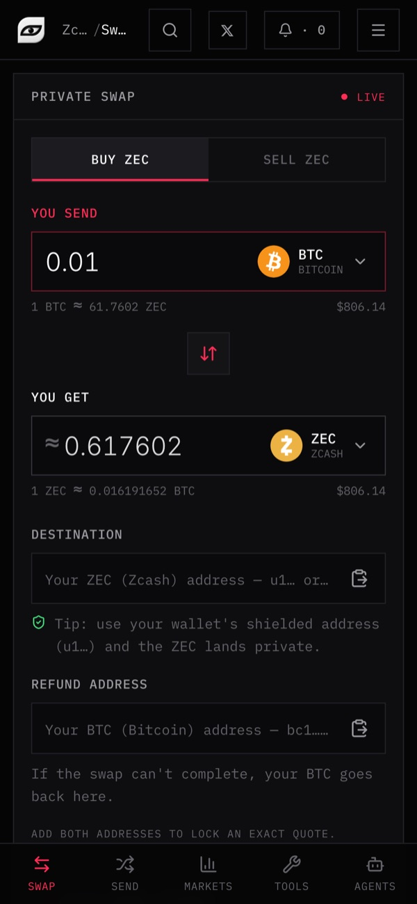
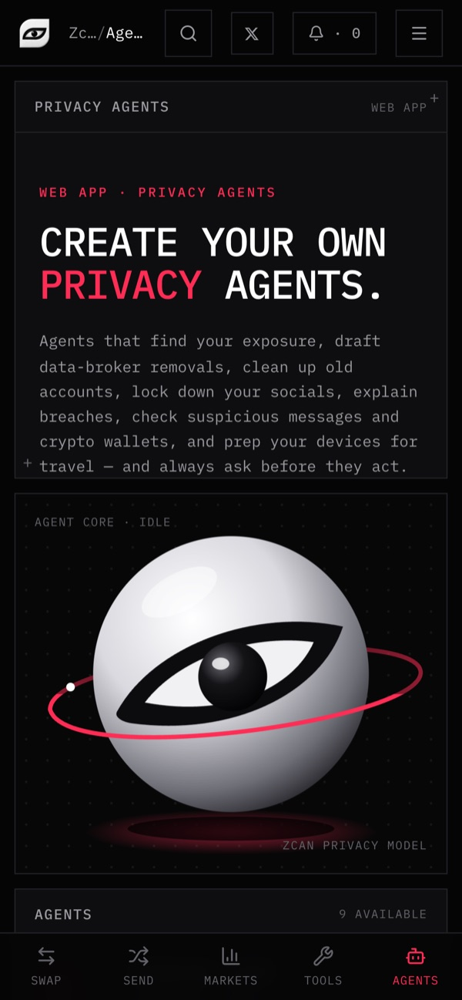
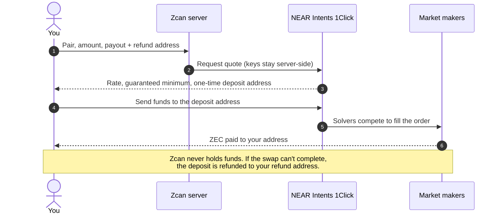
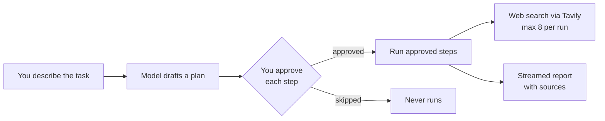

<p align="center">
  <a href="https://www.zcan.dev"></a>
</p>

<p align="center">
  
</p>

<h1 align="center">Zcan</h1>

<p align="center">
  <b>Less exposed. More in control.</b><br>
  Private swaps into Zcash, privacy tools that never leave your device, and AI agents that ask before they act.
</p>

<p align="center">
  <a href="https://www.zcan.dev"></a>
  <a href="LICENSE"></a>
  <a href="https://github.com/OpenComDev/zcan/actions/workflows/ci.yml"></a>
</p>

<p align="center">
  
  
  
  
  
  
  
</p>

<p align="center">
  <a href="https://www.zcan.dev">Website</a> ·
  <a href="#features">Features</a> ·
  <a href="#how-a-swap-works">How it works</a> ·
  <a href="#quick-start">Quick start</a> ·
  <a href="#deploy-your-own">Deploy</a> ·
  <a href="CONTRIBUTING.md">Contributing</a> ·
  <a href="SECURITY.md">Security</a>
</p>

<br>

<p align="center">
  <a href="https://www.zcan.dev"></a>
</p>

## Why Zcan

Most crypto and privacy apps ask you to trust them. Zcan is built so you don't have to:

- **No accounts, no custody.** Swaps settle through [NEAR Intents](https://docs.near-intents.org); Zcan never holds your funds and never asks who you are.
- **Local first.** The link and photo cleaners run entirely in your browser. Nothing is uploaded.
- **Agents that ask first.** Every privacy agent shows its plan and waits for you to approve each step before it does anything.
- **Its own model.** The agents run on an open-weights model Zcan hosts itself, not an AI company's API. Prompts aren't logged.
- **Radically transparent.** The [Transparency page](https://www.zcan.dev/transparency) lists, feature by feature, exactly what leaves your device and who receives it. And now the code is open, so you can check.

## Features

<table>
  <tr>
    <td width="50%" valign="top">
      <h3>⇄ Private swap</h3>
      Any of 200+ assets ↔ ZEC in one step, with live quotes, a guaranteed minimum and a refund address. Pay out to a shielded <code>u1…</code> address and the ZEC lands private. Automatic backup route if the main one goes down.
    </td>
    <td width="50%" valign="top">
      <h3>◎ Privacy agents</h3>
      Nine agents: Exposure Scout, Breach Guide, Access Auditor, Data Broker Remover, Account Cleanup, Social Media Lockdown, Phishing Check, Wallet Hygiene and Travel Privacy. Plan → approve → run, with live web sources.
    </td>
  </tr>
  <tr>
    <td></td>
    <td></td>
  </tr>
  <tr>
    <td valign="top">
      <h3>⤳ Private send</h3>
      Split one amount across up to 10 recipients, with custom shares and staggered delays. Each leg is its own order paid by a market maker, so recipients never see your wallet.
    </td>
    <td valign="top">
      <h3>⌁ Privacy tools</h3>
      A link cleaner that strips trackers and unwraps redirects, and a photo cleaner that reveals and removes EXIF, GPS, XMP and IPTC data. Both work offline.
    </td>
  </tr>
  <tr>
    <td></td>
    <td></td>
  </tr>
  <tr>
    <td valign="top">
      <h3>▤ Markets &amp; alerts</h3>
      Live ZEC price from Coinbase ticks, 24h history, and price or pair-rate alerts stored only in your browser.
    </td>
    <td valign="top">
      <h3>◈ Transparency</h3>
      Live service health and a per-feature map of what leaves your device, checked against the code.
    </td>
  </tr>
  <tr>
    <td colspan="2"></td>
  </tr>
</table>

**Also inside:** payment request links, order tracking, a ⌘K command palette, a Manifest V3 browser extension (clean links on copy, clipboard address guard), installable PWA, guides and docs, and full translations in English, Spanish, Portuguese, Turkish, Russian and Chinese.

<p align="center">
  
  &nbsp;&nbsp;&nbsp;
  
</p>

## How a swap works



| Mode | 1Click `swapType` | Behaviour |
| --- | --- | --- |
| Floating (default) | `EXACT_INPUT` | Fixed send amount. Receive amount is estimated, with a 1% guaranteed minimum. |
| Fixed rate | `EXACT_OUTPUT` | Fixed receive amount. Send amount includes a buffer, and any excess is refunded. |

If 1Click is unreachable and `CHANGENOW_API_KEY` is set, popular pairs fall back to fixed-rate [ChangeNOW](https://changenow.io) orders automatically, and the order page says which route was used.

## How the agents work



The model is any OpenAI-compatible API. The intended setup is **Zcan's own model**: open-weights
[`gpt-oss-20b`](https://huggingface.co/openai/gpt-oss-20b) served with vLLM on GPUs that scale to zero,
behind a proxy token, with prompt logging off. One command deploys it. See
[`deploy/model/README.md`](deploy/model/README.md).

`src/lib/ai-model.ts` keeps the site honest automatically: an outside AI provider is always named, and the
"own model" wording only appears when the endpoint really is self-hosted.

## Quick start

```bash
git clone https://github.com/OpenComDev/zcan.git
cd zcan
pnpm install
cp .env.example .env.local   # optional: swaps, tools and markets work without any keys
pnpm dev
```

Open [localhost:3000](http://localhost:3000). Requires Node 22+ and pnpm.

## Deploy your own

[](https://vercel.com/new/clone?repository-url=https%3A%2F%2Fgithub.com%2FOpenComDev%2Fzcan)

Everything is optional; [`.env.example`](.env.example) explains each variable. The main ones:

| Variable | What it turns on |
| --- | --- |
| `ONECLICK_API_KEY` | 1Click API key. Keyless quotes include a 0.2% 1Click fee. |
| `CHANGENOW_API_KEY` | Backup swap route, used only while 1Click is down. |
| `ZCAN_FEE_RECIPIENT` · `ZCAN_FEE_BPS` | Your own service fee, paid on-chain to a NEAR Intents account. |
| `AI_API_KEY` · `AI_BASE_URL` · `AI_MODEL` | The privacy agents. |
| `TAVILY_API_KEY` | Live web search for the agents. |
| `NEXT_PUBLIC_REOWN_PROJECT_ID` | "Pay with wallet" (WalletConnect) on order pages. |
| `KV_REST_API_URL` · `KV_REST_API_TOKEN` | Upstash Redis: shared rate limits, crash reports, opt-in training data. |

> [!IMPORTANT]
> The AGPL-3.0 requires you to share your source code if you run a modified version as a public service.
> The license covers the code, not the brand: please rename your deployment and use your own logo.

## Under the hood

| Layer | What's used |
| --- | --- |
| App | Next.js 16 App Router, React 19, TypeScript, Tailwind CSS 4, server-rendered in 6 languages |
| Swaps | NEAR Intents 1Click API, ChangeNOW (backup), on-chain fees through 1Click `appFees` |
| Live data | Coinbase WebSocket ticks, CoinGecko history, 1Click token list |
| Agents | Any OpenAI-compatible model (vLLM on Modal by default), Tavily search, streamed NDJSON |
| Wallets | Reown AppKit (EVM via wagmi, Solana) |
| Storage | Upstash Redis (optional); everything personal stays in the browser's local storage |
| Quality | Vitest unit tests, Playwright end-to-end tests, CI on every push, a Content Security Policy |

```
src/
  app/[lang]/        Pages (swap, send, agents, tools, markets, order, transparency, docs …)
  app/api/           Server routes: quote, status, tokens, agents, health, errors …
  components/        Exchange widget, token picker, order view, agent workspace …
  i18n/              All user-facing text, in 6 languages
  lib/               1Click and ChangeNOW clients, rate limits, link and photo cleaners, AI model wiring
deploy/model/        Zcan's own model on Modal (vLLM)
extension/           Browser extension (Manifest V3)
tests/               Unit (Vitest) and end-to-end (Playwright) tests
```

## Development

```bash
pnpm typecheck && pnpm lint   # types and lint
pnpm test                     # unit tests
pnpm build && pnpm test:e2e   # end-to-end tests against a production build
pnpm build:extension          # browser extension → extension/dist
```

GitHub Actions runs all of these on every push and pull request.

## Roadmap

- [x] Private swap, private send and payment requests
- [x] Nine privacy agents on a self-hosted model
- [x] Backup swap route
- [x] Browser extension
- [x] Signed agent plans (security review ZS-10)
- [ ] Shielded (`u1…`) payouts on more routes
- [ ] Self-hosted web search for the agents (SearXNG), so searches stay in-house too
- [ ] Fine-tuned Zcan model trained on opt-in, anonymized agent runs
- [ ] iPhone app: private browser, VPN and tools

Ideas welcome in [issues](https://github.com/OpenComDev/zcan/issues).

## Contributing

New here? Start with an issue labelled [good first issue](https://github.com/OpenComDev/zcan/labels/good%20first%20issue). See [CHANGELOG.md](CHANGELOG.md) for what's changed.


Pull requests are welcome: bug fixes, translations, new privacy tools. Read [CONTRIBUTING.md](CONTRIBUTING.md)
first. Found a vulnerability? Please report it privately; see [SECURITY.md](SECURITY.md).

## License

Zcan is free software under the [GNU Affero General Public License v3.0](LICENSE).

Zcan is an independent project and isn't affiliated with Electric Coin Co., the Zcash Foundation or NEAR.

<p align="center">
  <br>
  <a href="https://www.zcan.dev"></a>
  <br>
  <sub>Private intelligence, built your way.</sub>
</p>
